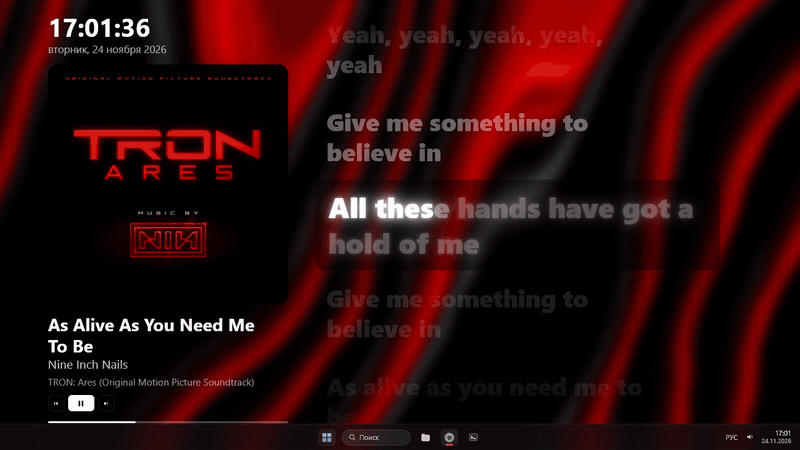

<div align="center">

# SpotifyLyricsWallpaper

**Живые обои рабочего стола для Windows 10 и Windows 11 с синхронными текстами песен, HD-обложками и аудио-визуализатором**

Синхронные тексты (LRCLIB), динамический фон по палитре обложки, эквалайзер, часы, управление плеером прямо с рабочего стола и пресеты — без стороннего софта вроде Wallpaper Engine.

[](https://github.com/apexFrog/spotify-lyrics-wallpaper/releases/latest)
[](https://github.com/apexFrog/spotify-lyrics-wallpaper/releases/latest/download/SpotifyLyricsWallpaper-win-x64.zip)
[](https://dotnet.microsoft.com/download/dotnet/8.0)
[](#требования)

<br>



---

### Быстрая загрузка

👉 **[Последний релиз (Latest Release)](https://github.com/apexFrog/spotify-lyrics-wallpaper/releases/latest)**  
📦 **[Скачать готовый ZIP-архив (`SpotifyLyricsWallpaper-win-x64.zip`)](https://github.com/apexFrog/spotify-lyrics-wallpaper/releases/latest/download/SpotifyLyricsWallpaper-win-x64.zip)**

</div>

---

## Возможности

- **Работает с любым плеером (Windows SMTC)** — автоматически подхватывает трек, обложку, статус воспроизведения и таймлайн из Spotify, Apple Music, Яндекс Музыки, YouTube Music, браузеров и любых других плееров с поддержкой системного медиа-виджета Windows.
- **Настоящие живые обои рабочего стола** — встраивается в слой рабочего стола (`WorkerW`) за иконками, поддерживает переключение в оконный режим, выбор монитора и автоматическую паузу при запуске полноэкранных приложений и игр.
- **Синхронные тексты песен (LRCLIB)** — 5 стилей анимации текста:
  - *Караоке* (`karaoke_flat`) — плавная подсветка текущей строки
  - *Классический* (`classic`)
  - *Печать с курсором* (`typing`)
  - *Плавное проявление букв* (`letters`)
  - *Прыгающие слова* (`jump`)
  - Настройка шрифта, тени, обводки, подложки активной строки, сдвига тайминга и размытия неактивных строк.
- **10 режимов живого фона по палитре обложки** — адаптивные волны (`Waves`, `Waves 2`, `Waves 3`), мягкие пятна (`Blobs`), градиентная сетка (`Mesh`), звёздный полёт с реакцией на громкость (`Stars`), снегопад (`Snow`), размытая обложка (`Blur Cover`), сплошной цвет (`Solid`) и собственное изображение (`Image`).
- **Аудио-визуализатор в реальном времени (WASAPI Loopback)** — 5 стилей эквалайзера (`Bars`, `Mirror`, `Dashes`, `Blocks`, `Wave`) с захватом системного звука через NAudio и выбором аудиоустройства.
- **Гибкий интерфейс и управление с рабочего стола** — 3 раскладки (`Classic`, `Mirror`, `Cinema`), стили обложки (`Rounded`, `Circle`, `Vinyl`), часы с датой и днём недели, прогресс-бар и кликабельные кнопки управления плеером и перемотки прямо на рабочем столе.
- **Пресеты с превью и автосменой** — сохранение пользовательских конфигураций с автоматическим скриншотом превью и ротацией пресетов по таймеру (по порядку или случайно).
- **Мультиязычный интерфейс** — русский, английский, китайский, японский и корейский (`RU`, `EN`, `ZH`, `JA`, `KO`).

---

## Установка и запуск

### Способ 1: Готовая сборка (рекомендуется)

1. Скачайте **[SpotifyLyricsWallpaper-win-x64.zip](https://github.com/apexFrog/spotify-lyrics-wallpaper/releases/latest/download/SpotifyLyricsWallpaper-win-x64.zip)** со страницы **[последнего релиза](https://github.com/apexFrog/spotify-lyrics-wallpaper/releases/latest)**.
2. Распакуйте архив в удобную папку (важно сохранить папку `www` рядом с `.exe`).
3. Запустите `SpotifyLyricsWallpaper.exe`.

> **Примечание:** Для запуска требуется [.NET 8 Desktop Runtime (x64)](https://dotnet.microsoft.com/download/dotnet/8.0) и [Microsoft Edge WebView2 Runtime](https://developer.microsoft.com/en-us/microsoft-edge/webview2/) (обычно уже встроен в Windows 10/11).

### Управление

- **Иконка в системном трее** — двойной клик или правый клик открывает меню:
  - *Настройки…* — современное окно настройки всех параметров в реальном времени (сохраняются в `%AppData%\SpotifyLyricsWallpaper\config.json`).
  - *Следующий пресет* — быстрое переключение между сохранёнными стилями.
  - *Режим: Обои / Окно* — переключение между слоем рабочего стола и обычным окном.
  - *Пауза / Продолжить* и *Перезагрузить обои*.
- **Клики прямо по рабочему столе** — кнопки управления треком (предыдущий / пауза / следующий) и перемотка по полосе прогресса работают прямо на обоях.
- **Автозагрузка Windows** — включается одной галочкой в настройках приложения.

---

## Сборка из исходников

### Требования

- Windows 10 (сборка 19041+) или Windows 11
- [.NET 8 SDK](https://dotnet.microsoft.com/download/dotnet/8.0)

### Быстрая сборка

Запустите `build.bat` — скрипт соберёт приложение в папку `dist\`.

Или выполните вручную в терминале:

```bash
# Запуск в Release-режиме
dotnet run -c Release

# Публикация в папку dist
dotnet publish -c Release -r win-x64 --self-contained false -p:PublishSingleFile=true -p:IncludeNativeLibrariesForSelfExtract=true -o dist
```

---

## Структура проекта

```text
SpotifyLyricsWallpaper/
├── assets/
│   └── demo.gif                       # Демонстрация работы на рабочем столе
├── Forms/
│   ├── WallpaperForm.cs               # Окно обоев на базе WebView2 + мост с JS
│   └── SettingsForm.cs                # Окно настроек и управления пресетами
├── Services/
│   ├── AppConfig.cs                   # Модель, сохранение настроек и автозагрузка
│   ├── AudioCaptureService.cs         # Захват системного звука (WASAPI Loopback / FFT)
│   ├── DesktopClickForwarder.cs       # Проброс кликов с рабочего стола в обои
│   ├── DesktopWallpaperHost.cs        # Встраивание окна в слой рабочего стола (WorkerW)
│   ├── PresetManager.cs               # Сохранение, превью и загрузка пресетов
│   └── SmtcMediaService.cs            # Интеграция с Windows SMTC (трек, таймлайн, обложка)
├── www/
│   ├── index.html                     # Рендерер обоев, фонов, текстов и эквалайзера
│   ├── settings.html                  # Веб-интерфейс настроек
│   ├── bridge.js                      # Мост совместимости между C# хостом и JS
│   └── project.json                   # Схема параметров и локализация
├── Program.cs                         # Точка входа (single-instance)
├── TrayApplicationContext.cs          # Системный трей, пауза в fullscreen, ротация пресетов
├── SpotifyLyricsWallpaper.csproj
└── build.bat                          # Сборка релиза в dist\
```
